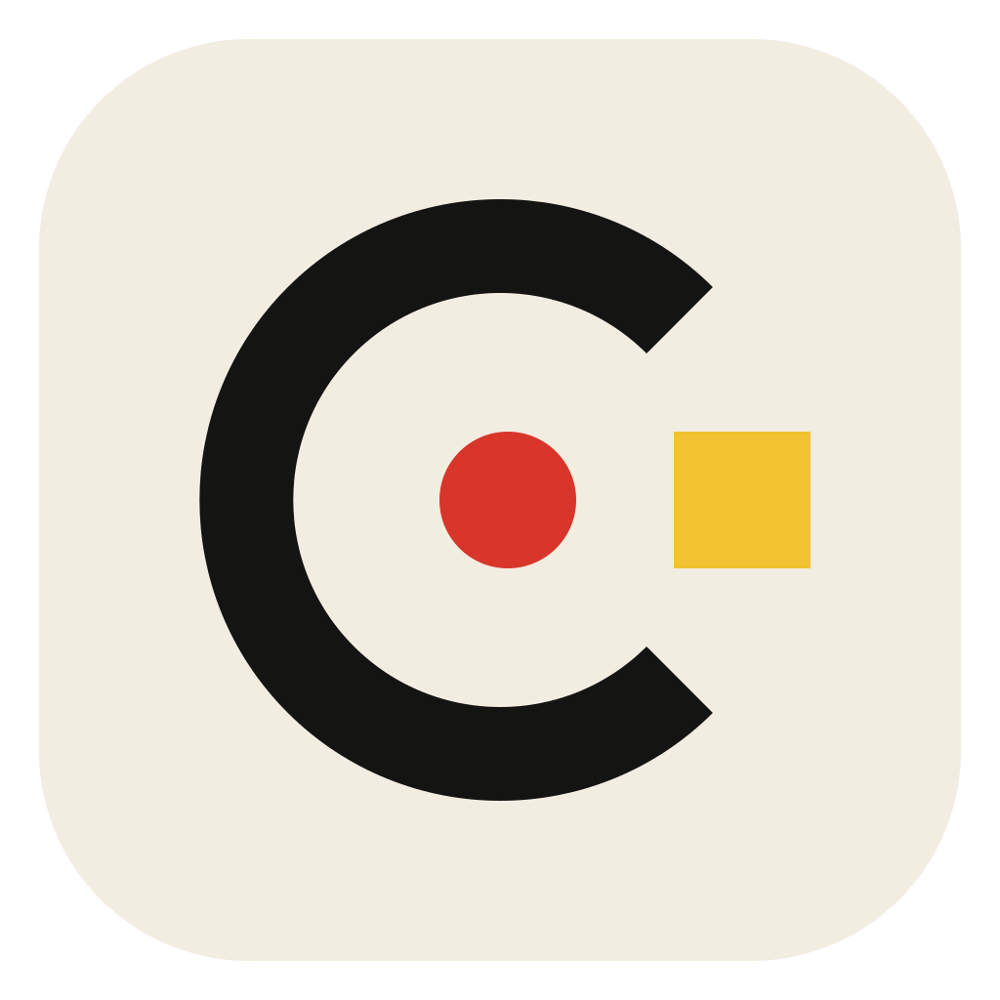
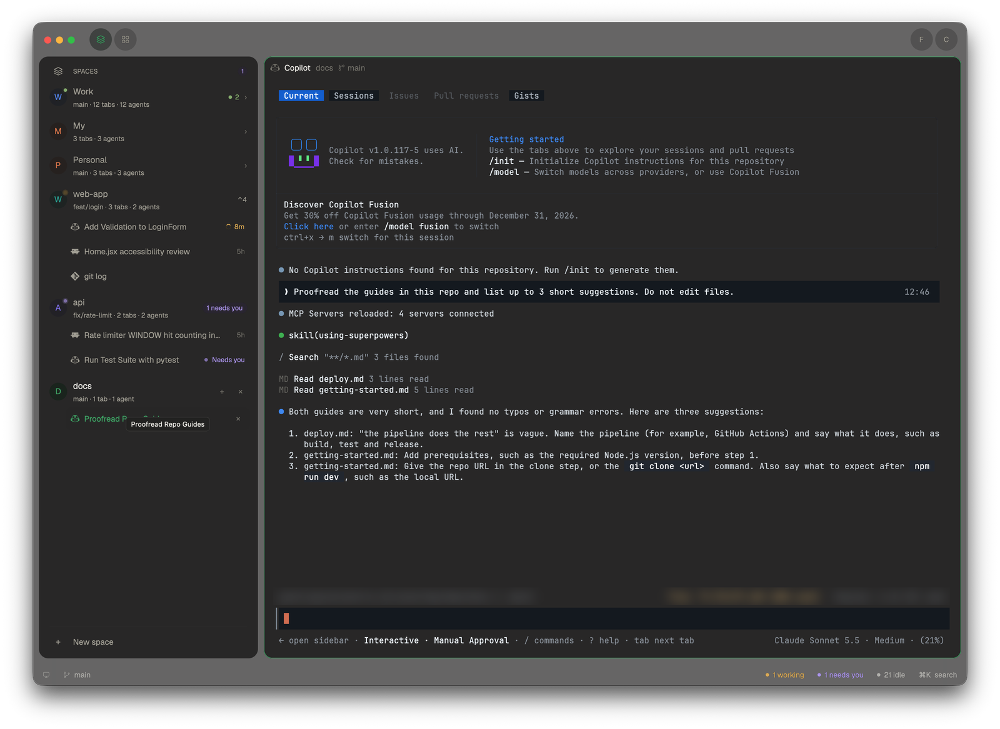
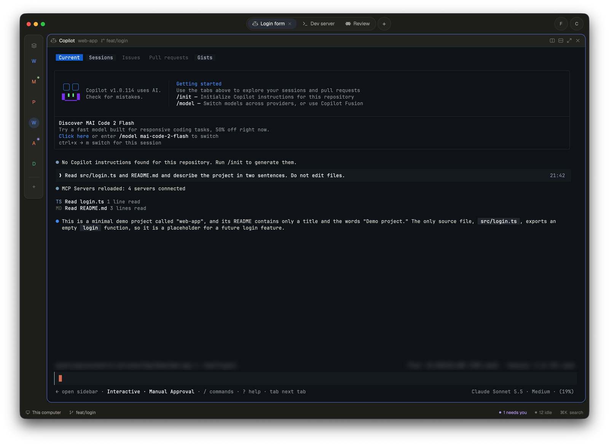
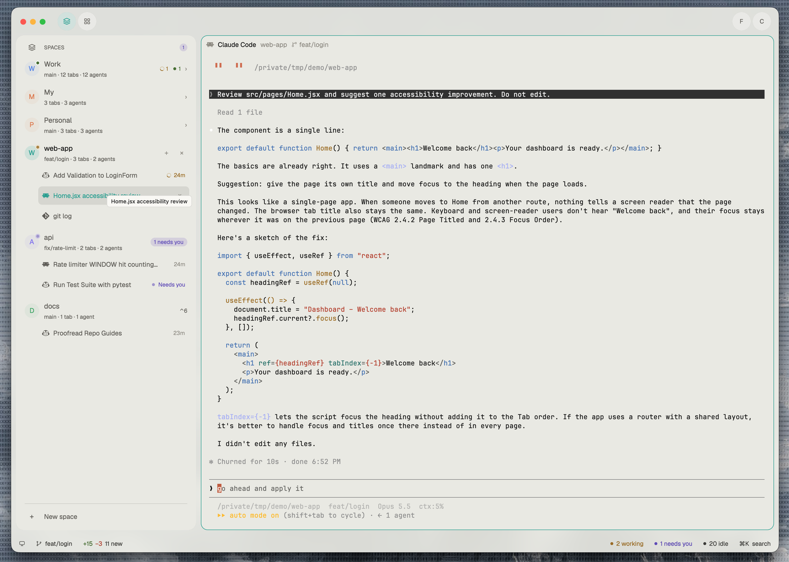
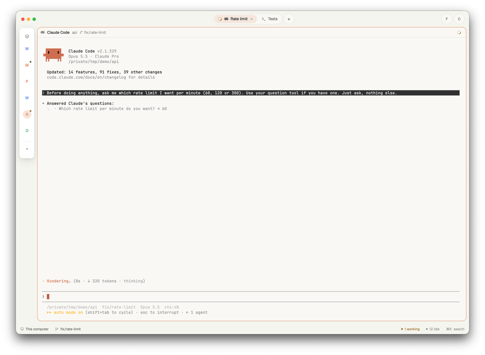

<p align="center"></p>

<h1 align="center">C-Studio</h1>

<p align="center"><strong>A calm, focused studio for <a href="https://herdr.app">Herdr.app</a>.</strong></p>

A layout for your coding agents that feels at home on a Mac. Everything you don't need right now steps back; the one agent that needs you comes forward.



- **Quiet by default.** Warm light and dark themes, soft edges, no noise. Notifications only when something went wrong.
- **One glance, every agent.** Working, done, or waiting on you – in the dock, the tabs and the status bar. ⌘J takes you to the next one that needs you.
- **Fits the screen you're on.** On a big monitor the dock stays open; on the laptop it folds away; the layers button in the tab bar (or ⌘B) brings it back.
- **Mission Control.** ⌘. (or the grid button beside the layers button) shows every agent as a card on the frosted window, grouped by what it needs from you.
- **Nothing gets lost.** Park a running agent instead of closing it, move tabs between spaces, find anything with ⌘K.

| Tab tray, dark | Dock pinned, light | Tab tray, light |
|---|---|---|
|  |  |  |

## Contents

- `layouts/c-studio.json` – the layout
- `layouts/c-studio-mc.json` + `mods/c-studio-mc` – Mission Control (⌘., the grid button in the tab bar, or the palette): a layout of its own, so the dock and terminals step aside and the window glass shows; every agent as a card (icon, title, repo · branch, space, a bar in its status color), newest first, in sections needs you / working / done / idle (click the idle header or press i to fold them), in a dark panel like the dock; filter by space with the round pills or Tab, arrows + ↩ or a click go to the agent, Esc, ⌘. or a click on the title go back
- `mods/c-studio-dock` – spaces dock with all tabs (pin or fold with ⌘B or the layers button in the tab bar; drag its edge to resize it (220–520 px, remembered), narrow to fold it, auto-pins when the window is ≥1500 px, folds below 1400 px; click the active space to collapse its tabs (a collapsed space shows how many agents are working or done); spaces in their colors (right-click a space to pick one or rename it), program icons in one color, drag to reorder tabs or drop one on another space to move it, × on hover)
- `mods/c-studio-tabs` – tab bar with agent session titles; active tab as a soft pill in the space color, status dot first; centered in one rounded tray with at most 4 tabs, fewer as the window narrows (3 under 1200 px, 2 under 1000, 1 under 800; the active one always shown; the tray never slides over the buttons beside it), round ⌄ and + buttons beside it (⌄ shows how many tabs are hidden and lists them), round F / C panel toggles on the right; ⌘J jumps to the next agent that needs you, in any space
- Panes you are not in fade a little (`veil` on the pane frame), so the one you work in stands out
- `mods/c-studio-pane` – terminal pane header: the pane's name if you gave it one (else the program), repo-relative folder and git branch; buttons fade in on hover; a maximized pane shows "+N hidden" (click to restore), and its tab gets a badge
- `mods/c-studio-status` – status bar; a monitor icon for this computer (remote spaces show the machine name); click working / needs you / idle to cycle agents, click the branch to copy it; ↑ahead ↓behind pushes or fast-forward pulls; a ● C-Studio x.y.z pill when a newer release is tagged
- `mods/c-studio-update` – what's new in that release (from CHANGELOG.md); Update pulls the clone you installed from and reruns `install.sh`, Later hides it until the next release
- `mods/c-studio-switch` – ⌃Tab switcher, like ⌘Tab for apps: hold ⌃ and press Tab (⇧Tab goes back) to walk your recent tabs across all spaces, release ⌃ to go there; a quick ⌃Tab flips to the previous tab, Esc cancels
- `mods/c-studio-palette` – Spotlight-style ⌘K / ⌘P search for tabs, spaces, agents and actions: fuzzy ("cc" → Claude Code), recent first, tabs sorted by Status, Recent or A–Z (tab switches), ⌘R renames and ⌘⌫ closes the selected tab, "Move tab to …" moves the focused tab to another space (processes keep running); parked terminals are listed too (↵ resumes one as a tab, ⌘⌫ ends it)
- Files / Changes side panel (Herdr's `files` and `changes` mods): F / C in the tab bar, ⇧⌘E / ⇧⌘G, or click +N −M in the status bar; remembered per space, folds under 1100 px; on a narrow window opening it folds the spaces dock, which comes back when the panel closes
- `mods/c-studio-close` – × / ⌘W on a tab running more than a shell asks: Park (keep it running in the background), Close, or Cancel; on a pinned tab it asks before closing
- `mods/c-studio-menu` – right-click on a tab (tab bar or dock): Rename, Pin / Unpin, New tab, Close
- Pinned tabs: ⌃⌘P, the tab menu or the palette pins a tab; it moves to the front of its space, shows as just its icon in the tab bar and with a pin in the dock, palette and switcher
- Spaces stay open: when a space's last tab is closed, parked or moved, a "New tab" launcher takes its place (it goes once a real tab opens); a space closes only with its own ×
- `mods/c-studio-launch` – new-tab launcher (⌘K → New tab…; ⌘T and + open a terminal straight away): Terminal or an installed agent, in the folder you came from, a recent folder (⌥1–5), or a new worktree
- `mods/c-studio-links` – ⌘-click in a terminal: a code file opens in VS Code at the clicked line (`app.ts:42:7`), an image or PDF in Quick Look; remote terminals and everything else keep Herdr's handling
- Pane resize from the keyboard: ⌘⇧ + arrows; previous / next tab with ⌃⌘←/→ and space with ⌃⌘↑/↓ (no [ ] keys, so they work on any keyboard layout)
- `mods/c-studio-toast` – quiet notifications: only errors and warnings show (agent status lives in the dots), in the palette style (long messages wrap and scroll; hover for the full text), with a Go button when they lead somewhere
- `themes/c-studio-{dark,light}.json` – warm palettes used by the layout; `c-studio-{dark,light}-<color>.json` are accent variants that c-studio-status switches to so the focus border follows the space color
- `hooks/copilot/herdr-status.{sh,json}` – Copilot CLI hooks that report the agent status to Herdr (OSC 7501): working, done, and needs you only for a real permission prompt or a question to you (not `permissionRequest`, which fires for every tool); installed in `~/.copilot/hooks`, new Copilot sessions pick them up
- `keys.c-studio.json` – `layout:c-studio` key bindings, merged into `keys.json`
- `RECIPE.md` – the brief another agent can rebuild C-Studio from (herdr.dev gallery format)

## Requirements

- macOS and [Herdr.app](https://herdr.app) 0.1.18 or later (the key bindings use ⌘)
- Herdr's built-in `files`, `changes` and `workspace-chrome` mods (shipped with the app; the side panel and some icons come from them)
- `python3` for `install.sh` (merges the key bindings)
- Optional: [Visual Studio Code](https://code.visualstudio.com) for ⌘-click on code files
- Optional: [GitHub Copilot CLI](https://github.com/github/copilot-cli) for the status hooks; other agents rely on Herdr's own status detection

## Install

```bash
./install.sh
herdr-app do layout.switch '{"name":"c-studio"}'
```

To install a specific version, check out its tag first (`git checkout v0.1.0`); see [CHANGELOG.md](CHANGELOG.md) for what changed.

## Uninstall

```bash
./uninstall.sh
```

Switches back to Herdr's `main` layout and removes the C-Studio layout, themes, mods, `layout:c-studio` key bindings (`keys.json` is backed up first) and the Copilot status hooks. Quit Herdr first to also clear the state it remembers (dock width, folded spaces, recent folders).

## Update the repo after tweaking the layout

```bash
./sync.sh   # copies the files from ~/.config/herdr-app, shows git status
```

`kit.js` (panel toggling, tab names, dock pinning) is shared code. Herdr only resolves imports inside a mod's folder, so each mod that uses it keeps an identical copy: edit one, copy it to the others, and `sync.sh` stops if they differ.

Shipped Herdr layouts and mods are overwritten on app start; this repo only holds the custom ones.
