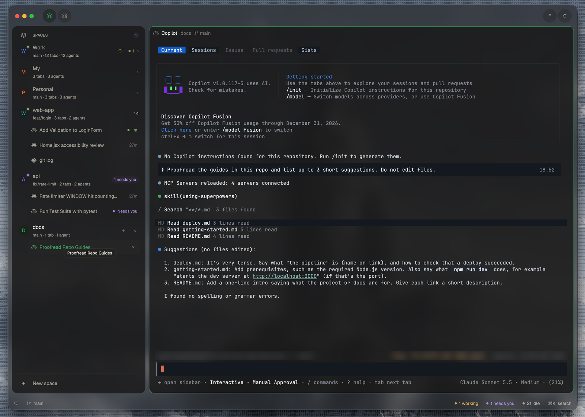

# C-Studio

A calm, focused studio for Herdr.app: a macOS-style window for coding agents. A single rounded tab tray runs along the top. A spaces dock sits on the left: pinned on a big monitor, folded into an icon strip on a laptop. The terminal panes have soft edges, and a quiet status bar runs along the bottom. Warm light and dark themes follow the system. Agent status (working, needs you, done) shows as dots and spinners everywhere, and ⌘J jumps to the next agent waiting on you.

## What you see

Top to bottom:

- **Tab bar (48 px, window drag area).**
  - No title bar; the traffic lights sit at (18, 22).
  - Tabs are centered in one rounded tray, with at most 4 visible; the active tab is always shown.
  - The active tab is a soft pill tinted with its space's color. Each tab shows its status dot first, then the agent session title or the program name.
  - Round buttons on the left of the tray:
    - ⌄ has a badge with the number of hidden tabs and lists them.
    - \+ opens a new terminal.
  - Round **F** / **C** buttons on the right toggle the Files / Changes panel.
- **Body row** (10 px padding, 10 px gap):
  - **Sidebar (56–520 px).**
    - The spaces dock, one row per space: a color square with the initial, the name, and the space's tabs beneath it. Each tab row has a monochrome program icon, a name, a status dot or spinner, and an "ago" time.
    - When the dock is not pinned, it hides completely and the window edges match. A round layers toggle at the left of the tab bar (always there, in the space color while the dock is open) shows or hides it; spaces also switch with ⌃1–9, ⌃⌘↑/↓ and ⌘K; tabs with ⌃⌘←/→.
  - **Main.** The active tab's panes:
    - The pane background is `background`, with a 1 px `border` and a 1 px `accent` border on focus. Radius 14, 10 px gap; a lone pane keeps its chrome. `veil: 0.35` fades the panes you are not in.
    - Each pane has a 36 px header (`c-studio-pane`) showing:
      - the pane's name (`pane.rename`), else the program; the repo-relative folder and git branch;
      - a spinner while working;
      - split-right, split-down, zoom and close buttons that fade in on hover.
  - **Side panel (hidden by default, 280–700 px, radius 14, `surface` background like the terminal card, so dim text and buttons stay readable).** A stack of Herdr's `files` and `changes` mods.
- **Status bar (36 px).**
  - A monitor icon for this computer (tooltip "This computer"); a remote space shows a server icon and the machine name.
  - Working, needs-you and idle counts.
  - The branch, with ↑ahead ↓behind.
  - +N −M diff stats for the focused pane's repo.

Themes:
- `c-studio-dark`: background `#262624`, chrome `#1f1e1d`, accent `#d97757`.
- `c-studio-light`: warm off-white.
- Working is amber, blocked is lavender, done is green.
- Fonts: SF Mono 14 for the terminal, Geist for the UI.
- Terminal padding is 16×14.
- Twelve accent variants, `c-studio-{dark,light}-{blue,green,orange,pink,teal,violet}`, differ only in `accent`/`cursor`/`selection`. `c-studio-status` switches to the variant that matches the focused space's color, so the focus border follows the space.

## How it behaves

- **Agent status:**
  - **Working:** a spinning `workspace-chrome/spinner.svg` in the `working` color.
  - **Blocked (needs you):** a lavender dot pulsing in opacity (1.4 s).
  - **Done:** a green dot.
  - **Idle:** a dim dot.
  - In the status bar, clicking working / needs you / idle cycles focus through those agents.
  - ⌘J goes to the next blocked agent in any space.
- **Dock:**
  - ⌘B pins or unpins it. It auto-pins when the window is ≥1500 px wide and folds below 1400 px.
  - Dragging the sidebar edge resizes it (220–520 px, remembered). Narrowing it past the minimum folds it.
  - Clicking the active space collapses its tabs. A collapsed space shows a spinner + count of working agents and a dot + count of done agents. Double-click is ignored.
  - Right-click a space for color and Rename…
  - Drag tabs to reorder them, or drop one on another space to move it (the process keeps running).
  - Hovering a tab shows ×.
- **Tabs:**
  - ⌘T and + open a terminal in the current folder.
  - ⌘W / × on a tab running more than a shell opens `c-studio-close`: Park (the terminal keeps running in the background), Close, or Cancel.
  - When a space's last tab goes, a "New tab" launcher (`c-studio-launch`) takes its place. The space only closes with its own ×.
- **Launcher:**
  - Terminal, or any installed agent (`knownAgents`).
  - Folder: the folder you came from, a recent folder (⌥1–5), or New worktree… (opens Herdr's `worktree` dialog).
- **Palette (⌘K / ⌘P, `c-studio-palette`):**
  - A Spotlight-style popup with fuzzy search over tabs, spaces, agents, actions and parked terminals, recent items first.
  - ⌘R renames and ⌘⌫ closes the selected item; ↵ on a parked terminal resumes it as a tab.
  - "Move tab to …" moves the focused tab to another space.
  - With an empty query, tabs are sorted by Status (needs you, done, working, the rest), Recent (the ctrl+tab order, the current tab last) or A–Z. Switch with a click or tab / shift+tab; the choice is kept in `c-studio-palette.sort`.
- **Pinned tabs (⌃⌘P, `c-studio-tabs.pin`):**
  - Pin from ⌃⌘P, the right-click menu (`c-studio-menu`, which replaces Herdr's tab menu) or "Pin tab" in the palette. The list is `c-studio.pinned`.
  - Pinning runs `tab.move` to the front of the space, after the other pinned tabs, so ⌘1–9 and prev / next follow. `keepPinnedFirst()` in `c-studio-tabs` moves a pinned tab back if a drag leaves it behind.
  - The tab bar shows a pinned tab as just its icon (the name is the tooltip) with no ×; the dock, palette and switcher add a pin. The palette lists pinned tabs first in every sort; the switcher keeps its recent order.
  - ⌘W, × or Close on a pinned tab asks first (`c-studio-close` with `pinned`).
- **Switcher (⌃Tab / ⌃⇧Tab, `c-studio-switch`):**
  - Like ⌘Tab for apps: recent tabs across all spaces, newest first, with status, program icon and space.
  - Tab / ⇧Tab (or ↑ / ↓) step while ⌃ is held; releasing ⌃ selects, Esc cancels. The list fades in after 140 ms, so a quick ⌃Tab just flips back.
  - `c-studio-tabs` records the recent order (`c-studio.recent`) and runs `switch` / `switch_back`, which open the popup or step it.
- **Panel:**
  - Toggled by F / C, ⇧⌘E / ⇧⌘G, or a click on +N −M.
  - Its state is remembered per space, and it folds when the window is narrower than 1100 px.
  - If dock + panel would leave the terminal under 900 px, opening the panel folds the dock (`c-studio.dock-yielded`); closing the panel pins it again, unless the dock was toggled meanwhile. `c-studio-tabs` publishes the window size (`c-studio.viewport`) from its render pass.
- **Status bar:** clicking the branch copies it; ↑ pushes, ↓ runs `git pull --ff-only`.
- **Update notice:** `install.sh` writes `c-studio.json` (`version`, and `source` when installed from a git clone). Every 6 hours `c-studio-status` reads the `v*` tags of that clone (`git fetch --tags`), else GitHub's tags API, and shows ● C-Studio x.y.z when one is newer. The pill opens `c-studio-update`: the CHANGELOG sections since the installed version; Update runs `git pull --ff-only` and `install.sh` (without a clone it opens the release page); Later skips that version.
- **⌘-click links (`c-studio-links`):** a code file opens in VS Code at the clicked line (`vscode://file/<path>:<line>:<col>`; from Herdr's `link.line`/`link.column`, so `src/app.ts:42:7`; Herdr skips bare filenames like `app.ts:42` and strips `(42,7)`, which then opens at the top); images and PDFs open in Quick Look (`qlmanage -p`, in the background). Remote terminals, URLs and other files pass to Herdr.
- **Pane resize:** ⌘⇧ + arrows run `pane.resize {direction}` (40 px a press). Not ⌃⌘: macOS swallows it before Herdr sees it.
- **Toasts (`c-studio-toast`):** only errors and warnings are shown, in the palette style. Herdr sizes only its own `toast` to fit, so this one stays 340×72: the body wraps and scrolls (title `flex_none` so it never shrinks away) and its tooltip holds the full text; with a Go button when there is a target.

## Built from

- **Layout `layouts/c-studio.json`:**
  - A `column` root with `titlebar: "none"`, `toast: "c-studio-toast"`, `link_handlers: ["c-studio-links"]` and themes light/dark.
  - Blocks: `tabs`, then `work-body`, then `status`.
  - `work-body` is a resizable `row`:
    - `sidebar` column (hidden while folded) holding `dock-docked`, which runs `c-studio-dock` with `props: {docked: true}`;
    - `main` block with `tab: "active"` and a `pane` style plus a header mod;
    - hidden `panel` column with a `panel-body` stack of `files` / `changes`.
  - A floating `dock` copy that draws nothing and only handles ⌘B: Herdr paints a floating block's frame with the solid theme background, so it can't be glass.
  - Glass: root `window_blur: true`; themes set `colors.background` fully transparent, `canvas` at 55% and a translucent `border`; the dock uses `glass(t)` from `kit.js` (the canvas tint at an alpha that brings the total cover to 65% whatever the canvas alpha). Tabs and the round header buttons (dock toggle, ⌄, +, F, C) share one look: 60% glass, 65% under the pointer, and when selected 65% mixed with the space color. `terminal_opacity: 0` lets the solid, rounded `surface` pane frame show behind terminals (at 1 the terminal paints a square background that leaks out of the rounded corners); it only applies after switching layout away and back.
- **Mods:**
  - `c-studio-dock`, `c-studio-tabs`, `c-studio-pane` (a clone of `pane`), `c-studio-status` (a clone of `workspace-status`), `c-studio-toast` (a clone of `toast`);
  - `c-studio-palette` (popup overlay, 620 wide, at top + 110), `c-studio-switch` (popup overlay, 520 wide, at top + 150), `c-studio-close` (dialog), `c-studio-menu` (popup, 200 wide), `c-studio-launch` (focusable view), `c-studio-links` (no view: `link.js` exports `handleLink`; `mod.json` `link_handlers` rules match image/PDF and code-file paths).
  - `kit.js` holds the shared helpers: panel toggling, tab names, dock pinning, move tab, pinned tabs, space colors, program icons. It is identical in dock, tabs, status, palette, close, switch and menu, because imports only resolve inside a mod's folder.
- **Shipped mods used:**
  - `files`, `changes` and `worktree`;
  - `workspace-chrome` for its SVGs (spinner, layers, search, git-branch, terminal).
- **Commands:**
  - `tab.*`: new, close, move, rename, select.
  - `space.*`: new, close, rename, select.
  - `pane.*`: split, zoom, focus, close.
  - `terminal.*`: park, keep, kill.
  - `layout.*`: show, hide, resize, select, switch.
  - `mod.open`.
  - `window.*`: minimize, maximize, close.
  - `app.*`: theme, palette, settings.
- **Shared keys:**
  - `dock.pinned`, `dock.width`, `dock.folded`, `space.colors`;
  - `c-studio.move`, `c-studio-palette.space`, `c-studio-palette.recent`, `c-studio-palette.sort`, `c-studio.recent`, `c-studio.pinned`, `c-studio-switch`, `c-studio-launch.folders`, `new-menu.agents`.
- **Programs run:**
  - `git`, read-only (`rev-parse`, `diff --shortstat`, `ls-files`, `rev-list`). The only writes are `git push` / `git pull --ff-only`, and only on a click.
  - `hc get/label/keep`, to move a tab's terminal to another space.
  - `sleep`.
  - `open vscode://file/…` and `qlmanage -p`, only on a ⌘-click.
- **Network:** nothing is fetched, except that git push/pull reaches your remote.
- **Keys** (`keys.c-studio.json`, section `layout:c-studio`):
  - ⌘B dock;
  - ⌘J next waiting agent;
  - ⌘K / ⌘P palette;
  - ⌘T new tab, ⌘W close tab;
  - ⇧⌘E files, ⇧⌘G changes;
  - ⌘⇧ + arrows resize the pane.

## Watch out

- **Install with `./install.sh` when you can.** It copies the layout, the 14 themes and the mods, merges `keys.c-studio.json` into `keys.json`, and installs the optional Copilot CLI status hooks (`hooks/copilot/` → `~/.copilot/hooks`). If you copy only `layouts/` and `mods/`, the themes are missing: also copy `themes/c-studio-*.json` and merge the key section.
- **macOS only.**
  - The keys use ⌘, and the glyphs in the UI are hardcoded ⌘ ⌥ ⇧.
  - On Linux and Windows `cmd` becomes Ctrl, which clashes with terminal keys.
  - Tested on Herdr 0.1.18 (`veil` and link line/column need it).
- **`space.colors` is shared** with Herdr's `spaces` / `picker` mods: write it by merging, and never delete it.
- **Sizes and counts:**
  - The tray shows at most 4 tabs.
  - The breakpoints (1500 / 1400 / 1100 px) are in `c-studio-tabs`.
  - The dock is clamped to 220–520 px.
- **Copilot status:** Copilot CLI reports needs-you only through the hooks. They fire on real permission prompts and `ask_user`, not on `permissionRequest`, which fires for every tool. Other agents rely on Herdr's own detection.
- **Deliberate choices:** the layout is `resizable: false` at the root, and the sidebar is resized only through `layout.resize` from the dock.
